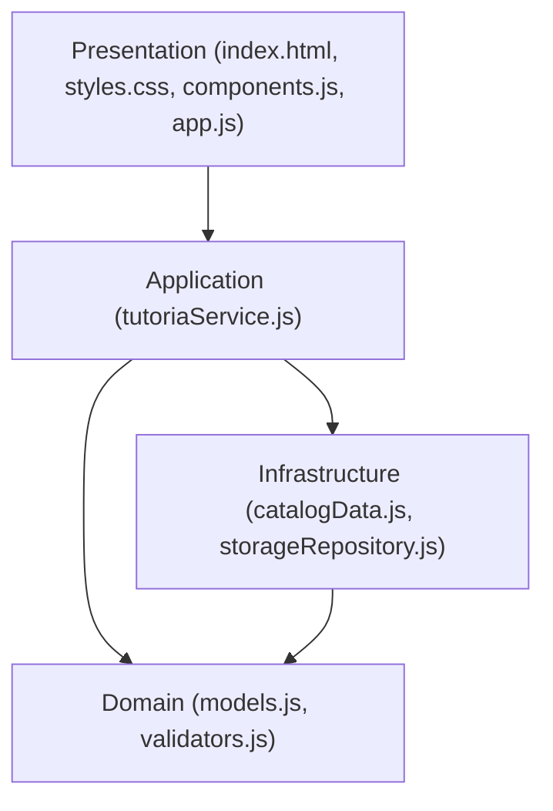

# Arquitectura de Software — Tutoría UX

El proyecto implementa una **arquitectura en capas** (inspirada en Clean Architecture / DDD ligero) con módulos ES6 nativos, sin dependencias externas en tiempo de ejecución.

## Diagrama de Capas

## Responsabilidades por Capa

1. **`src/domain/` (Dominio)**
   - `models.js`: Define entidades y constantes (`MODALIDADES`, `ESTADOS_RESERVA`, `crearEntidadReserva`, `generarCodigoReserva`). Sin dependencias del DOM ni de almacenamiento.
   - `validators.js`: Reglas puras de negocio (`validarDatosReserva`, validación de correo, longitud mínima de motivo, días hábiles lunes a viernes, fechas no pasadas).

2. **`src/application/` (Aplicación)**
   - `tutoriaService.js`: Orquesta los casos de uso (`consultarDocentes`, `obtenerHorariosConEstado`, `crearReserva`, `modificarReserva`, `cancelarReserva`, `consultarReservas`, gestión de borrador). Garantiza que no existan reservas duplicadas en un mismo docente/fecha/horario.

3. **`src/infrastructure/` (Infraestructura)**
   - `catalogData.js`: Fuente de datos inicial de asignaturas y docentes de la FISEI.
   - `storageRepository.js`: Persistencia desacoplada mediante `localStorage` en el navegador y `crearMemoriaStorage()` para pruebas automatizadas en Node.js.

4. **`src/presentation/` (Presentación)**
   - `components.js`: Funciones puras de renderizado seguro (escapado HTML anti-XSS) para tarjetas de docentes, tarjetas de reservas y resúmenes.
   - `app.js`: Controlador de eventos del DOM, manejo de vistas, accesibilidad (`aria-live`, foco al primer error, `<dialog>` modal) y persistencia continua del borrador.
