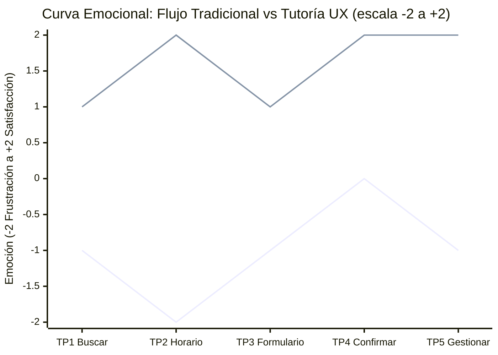

# Análisis de Experiencia de Usuario (UX) — Tutoría UX

## 1. Perfil de Usuario (Persona Principal)
- **Nombre ficticio:** Mateo Andrade (Estudiante de 5to semestre de Ingeniería de Software, FISEI - UTA).
- **Edad:** 21 años.
- **Contexto:** Cursa materias técnicas con proyectos integradores y laboratorios; alterna entre su teléfono móvil (en el campus) y su laptop (en casa).
- **Nivel tecnológico:** Alto en apps web/móviles, pero con poco tiempo disponible entre clases.
- **Frustraciones actuales:** Coordinar tutorías por correo o mensajes informales sin saber horarios libres reales, perder datos cuando un formulario falla, o no tener constancia clara de si la tutoría fue confirmada o cancelada.

## 2. Necesidades del Usuario
1. Consultar rápidamente qué docentes dictan una asignatura y en qué modalidad atienden.
2. Visualizar horarios libres en tiempo real sin tener que adivinar ni escribir correos previos.
3. Corregir errores o regresar a verificar un dato sin perder lo que ya escribió.
4. Recibir un comprobante/código claro de su reserva y poder modificarla o cancelarla ante cruces de horario.

## 3. Cinco Touchpoints del Proceso
1. **TP1 — Descubrimiento y filtrado de docentes:** El estudiante ingresa desde móvil o escritorio y filtra por asignatura o modalidad.
2. **TP2 — Selección de modalidad, fecha y horario:** Elige Presencial o Virtual, fecha hábil y franja horaria disponible.
3. **TP3 — Registro de datos y revisión previa:** Ingresa su nombre, correo y motivo, y verifica el resumen antes de confirmar.
4. **TP4 — Confirmación y código de reserva:** Obtiene el código `TUT-2026-XXXX` y el estado `Confirmada`.
5. **TP5 — Gestión posterior (Mis Reservas):** Consulta su reserva, la modifica o la cancela liberando el cupo.

## 4. Dos Momentos Críticos
1. **Momento Crítico 1 (TP2–TP3): Choque de horario o error de validación al enviar.**
   - *Riesgo:* Si el sistema borra los campos ingresados o muestra un error genérico, el estudiante siente frustración y abandona el trámite.
   - *Solución aplicada:* Persistencia automática de borrador en `localStorage`, mensajes inline por campo, foco automático al primer campo con error y botón explícito para volver sin perder datos.
2. **Momento Crítico 2 (TP5): Cancelación o modificación de última hora.**
   - *Riesgo:* Cancelar accidentalmente con un solo clic o no saber si el cambio quedó guardado.
   - *Solución aplicada:* Diálogo modal accesible de confirmación para cancelar (con opción de mantener la reserva) y cambio de estado visible (`Modificada` / `Cancelada`).

## 5. Curva Emocional del Proceso de Reserva

- **Línea 1 (Proceso informal anterior):** Cae a `-2` en TP2 al no conocer horarios reales y sufrir rechazos por correo.
- **Línea 2 (Tutoría UX):** Se mantiene en zona positiva (`+1` a `+2`) gracias a filtros inmediatos, horarios ocupados visibles, conservación de borrador y confirmación con código.

## 6. Justificación de Oportunidades de Mejora
- **Paso de revisión previa (Paso 2):** Reduce errores humanos antes de confirmar la cita.
- **Deshabilitación preventiva de modalidades incompatibles:** Evita que el estudiante elija "Presencial" con un docente que solo atiende "Virtual" (prevención de errores de Nielsen).
- **Diseño Mobile First:** Permite agendar desde el celular en menos de 2 minutos entre clases.
